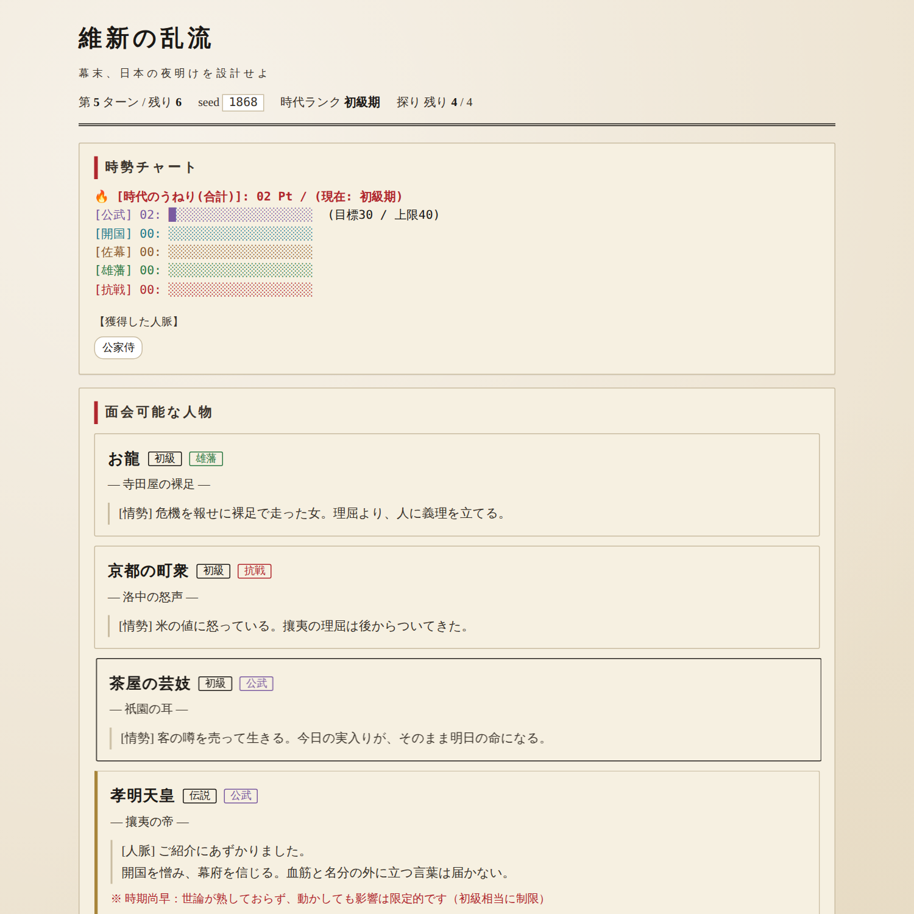

# 維新の乱流 ― 幕末、日本の夜明けを設計せよ ―



幕末を舞台にした歴史設計シミュレーション。戦闘も領地経営もない。
**人物の欲望・立場・論理を読み、言葉だけで歴史を動かす。**

原案は AI をゲームマスターとして動かすプロンプト
（[ミッキーベルグ氏 / note](https://note.com/mickey_bergdol/n/n1c29ef153438)）。
本リポジトリはそのルールを **LLM を使わない決定論的プログラム**として再実装したもの。

## 遊ぶ

`index.html` をブラウザで開くだけ。ビルド不要、依存なし、通信なし、外部ファイルなし。

## 30秒でわかる遊び方

1. 面会する人物を選ぶ（毎ターン3〜4名が現れる）
2. **支持する**か、**論破して転向させる**かを決める
3. 相手と**対話**する — 踏み込んだ問いを**一つだけ**ぶつけられる。返答はその者に何が刺さるかを語る
4. **論証カード**を3枚組む — 利益提示 / 文脈理解 / 論理整合（各3択）

| 一致 | 支持したとき | 転向を狙ったとき |
|:---:|:---|:---|
| 3枚 | 大成功。大きく時勢が動く | 大成功。自分の勢力が伸び、相手の勢力を削る |
| 2枚 | 成功。時勢が動く | **通らない**。転向は全か無かの賭け |
| 1枚 | 何も起こらない | 何も起こらない |
| 0枚 | 決裂。二度と現れず、**その縁筋も閉じる** | 同左 |

手がかりは各人物の**【情勢】描写**と、幕末史の知識。
読み切れないときは**「探る」**で3つの正解をすべて開けられる（獲得−1、1局4回まで）。

**旗色を鮮明にするほど、敵対する勢力の人物は耳を貸さなくなる。**
いずれかの時勢が12以上になると、対立する勢力の人物は判定が一段下がる。
寄せ切るか、抑えて回るか——これが最大の判断になる。

## 到達できる未来は16通り

- **単独覇権**（いずれか1つの時勢が30以上）— 5通り
- **複合革命**（上位2つの合計が30以上、かつ2番目が10以上）— **10通り、組み合わせごとに別の未来**
- **混沌**（いずれも満たさない）— 『歴史の藻屑』

## 決定論エンジン

**同じ seed と同じ選択なら、盤面は必ず同じになる。**
各画面下部の保存コード（`IR3:1868:24,0,3,3,511,0;…`）を控えれば、その局をいつでも完全に再現・共有できる。

- 乱数は seed 付き mulberry32 のみ。`Math.random` / `Date.now` は一切使わない
- ゲーム全体が `next = step(state, choice)` の純関数
- 登場人物は **151名**（初級30・中級60・上級45・伝説16）。1局で会えるのは約31名
- 名簿数を**素数**にしてあるのは意図的 — 法が合成数だと `gcd(ターン数, 法)` の倍数しか
  基点IDにならず、特定のターンで顔ぶれが潰れる

```sh
node tools/verify.mjs      # 決定論とルールの検証（111項目）
```

300 seed × 3回実行の state hash 一致、保存コードの往復、判定表とランク補正、
全16エンディングの到達可能性、名簿カバー率、非決定的APIの不在などを自動で確認する。

## 余話

主要人物69名には、史実側の短評と関連作品（司馬遼太郎作品、大河ドラマなど）を添えてある。
遊んだあとに実際の人物を知るための入口として、対話画面から開ける。

## 史実フィクションについて

**本作は史実を題材にしたフィクションです。**
人物の勢力分類・性格づけ・台詞・「刺さる動機」は、すべてゲーム上の解釈であり、
史実の評価ではありません。実在の人物・団体への評価を意図するものではありません。

## 権利について

ゲームのルール・判定表・エンディングの骨格・登場人物の枠組みは、
**ミッキーベルグ氏の原案に由来します**。本リポジトリのコード・文章・拡張部分
（151名への拡張、対立軸、探る、対話、複合エンド10通り、余話）は本リポジトリの著作物ですが、
原案部分の権利は原案者に帰属します。

ライセンスの設定・再配布・公開にあたっては、**原案者への確認を推奨します**。

## 構成

| パス | 内容 |
|:---|:---|
| `index.html` | ゲーム本体。エンジン部は `/* ==ENGINE START== */ … END */` で囲ってある |
| `docs/spec.md` | 仕様書。原作からの変更点と、仕様の穴に置いた既定値の一覧 |
| `tools/verify.mjs` | 決定論・ルールの検証（111項目） |
| `tools/smoke.mjs` | ブラウザでの通しプレイ確認（要 Playwright） |
| `screenshot.png` | README 用の画面 |

## 注意

リポジトリ直下の画像13枚（`altar.jpg` ほか）は**西洋ファンタジーの異世界アセット**であり、
本作とは無関係。ゲームはこれらを一切参照しない。
